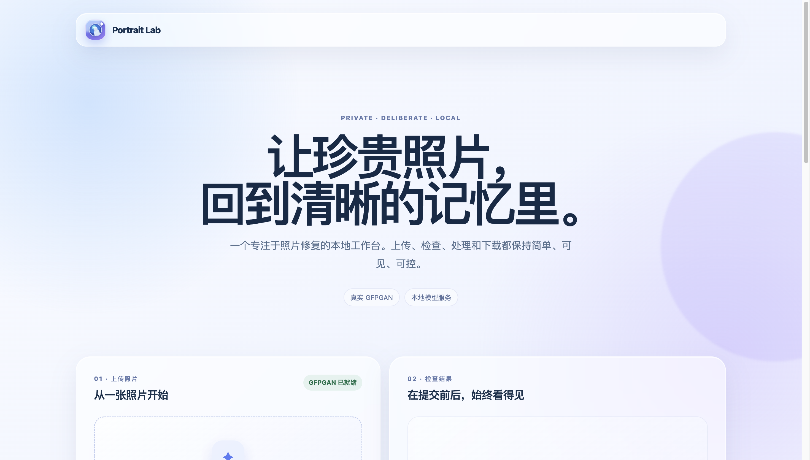
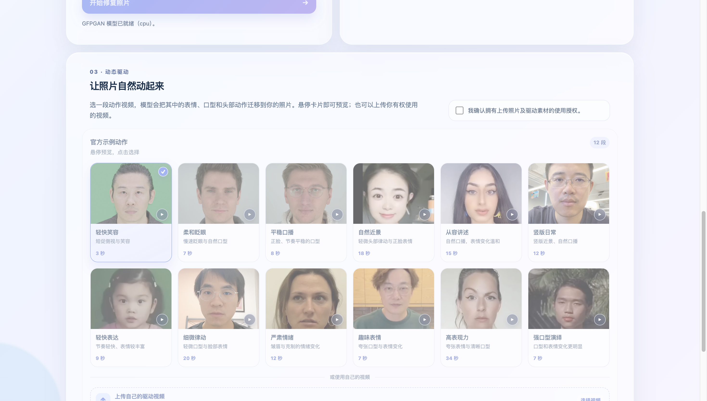

# Portrait Lab

<p align="center">
  A local-first macOS workspace for portrait restoration and consent-based portrait animation.
</p>

Portrait Lab pairs a Vue 3 interface with a small Flask API. Image restoration
uses GFPGAN in an isolated Python environment; optional portrait animation uses
the official LivePortrait runtime in a separate environment. Photos, results,
model weights, and driving videos remain on the Mac that runs the service.

## Interface

<p align="center">
  
</p>

<p align="center">
  <em>Local-first restoration workspace — no browser chrome, account information, or personal uploads are shown.</em>
</p>

<p align="center">
  
</p>

<p align="center">
  <em>Consent-based motion selection with the credited upstream sample library.</em>
</p>

## What it does

- Restore JPG, PNG, and WebP images with a 1×–4× GFPGAN workflow.
- Compare the selected image and result in one workspace and download the
  generated file locally.
- Generate a short animated portrait from an authorized driving clip using
  LivePortrait.
- Browse local LivePortrait sample clips as named preview cards, or provide an
  authorized MP4, MOV, or WebM clip for a single job.
- Run restoration and animation as persistent background jobs: the API
  answers in milliseconds with a job id, the UI polls (or listens over SSE),
  and job state survives an API restart.
- Let AI agents such as Claude Desktop and Claude Code restore and animate
  portraits through a local [MCP server](#use-portrait-lab-from-an-ai-agent-mcp).
- Run the model API only on `127.0.0.1`; uploads and generated media are not
  sent to a hosted service by this project.

## Architecture

```text
Vue 3 + Vite (localhost:5173)          Claude Desktop / Claude Code
          │  HTTP: submit → poll / SSE            │  MCP over stdio
          ▼                                       ▼
   Flask API (backend/app.py)          MCP server (backend/mcp_server.py)
          └──────────────┬────────────────────────┘
                         ▼
          PortraitService (backend/service.py)
          validation · UUID staging · private-clip cleanup
                         ▼
          JobManager + SQLite job table (backend/jobs.py)
          per-kind worker pools · pending-job limit · restart recovery
                ├── restore workers ── GFPGAN, isolated Python 3.10 environment
                └── animate workers ── LivePortrait, separate Python 3.10 environment + FFmpeg
```

## Background jobs

LivePortrait can run for up to 20 minutes, so neither endpoint holds the HTTP
request open while a model works:

1. `POST /api/restore` or `POST /api/animate` validates the upload, copies it to
   a UUID-named path, and answers `202 Accepted` with the job and a `Location`
   header. Invalid input still fails immediately (`400`, `413`, `422`), and a
   model that is not ready fails with `503` before anything is queued.
2. `GET /api/jobs/<id>` returns the job's `status` (`queued`, `running`,
   `completed`, or `failed`), its `queuePosition`, an `error` with a stable
   `code`, and — once completed — the same `result` fields the synchronous API
   used to return (`resultUrl`, `sourceUrl`, `model` or `animation`).
3. `GET /api/jobs/<id>/events` streams the same payload as Server-Sent Events
   until the job finishes, for clients that prefer push over polling.

```bash
curl -s -F image=@portrait.png -F scale=2 http://127.0.0.1:5000/api/restore
curl -s http://127.0.0.1:5000/api/jobs/<job id>
curl -N http://127.0.0.1:5000/api/jobs/<job id>/events
```

How the queue behaves:

- **Isolated worker pools.** Restoration and animation each get their own
  workers, so a long animation never delays a quick restoration.
  `RESTORE_CONCURRENCY` (default `2`) and `ANIMATION_CONCURRENCY` (default `1`)
  set the pool sizes. The GFPGAN and LivePortrait adapters still run one model
  call at a time per process, so larger pools overlap file handling rather than
  inference.
- **Back-pressure.** Each kind accepts at most `MAX_PENDING_JOBS` (default
  `16`) queued or running jobs; beyond that the API answers `429 queue_full`
  and discards the rejected upload. The capacity check and the insert are one
  SQL statement, so concurrent submissions cannot overshoot it.
- **Persistence.** Jobs live in SQLite (`backend/runtime/jobs.sqlite3`, WAL
  mode; override with `JOB_DB_PATH`). After a restart, queued jobs resume
  automatically and finished jobs keep their results. Each running job records
  the process that claimed it, and that process holds an OS file lock for as
  long as it lives. On startup, a running job whose process is gone is marked
  `failed` with code `interrupted` rather than retried, so one input that
  crashes the process cannot crash it again in a loop. Jobs owned by a process
  that is still alive are left alone.
- **Private clips stay single-use.** A custom driving video is deleted when its
  job ends, whether it completes, fails, or is interrupted.

## macOS quick start

### Prerequisites

- macOS on Apple Silicon or Intel
- [Homebrew](https://brew.sh/)
- Node.js 20 or newer
- Internet access for the first bootstrap (the upstream model downloads are several GB)

Install the system tools used by the setup scripts:

```bash
brew install node uv ffmpeg
```

If `git` is not available yet, run `xcode-select --install` once and accept the macOS Command Line Tools prompt.

### 1. Clone and prepare GFPGAN

```bash
git clone https://github.com/rick-a11/portrait-lab.git
cd portrait-lab
./scripts/bootstrap-gfpgan-macos.sh
```

The bootstrap creates the isolated Python 3.10 environment and downloads the official
GFPGAN weight plus the required FaceXLib detection and parsing weights. They are
stored only in ignored local directories; no manual model-file hunt is required.

### 2. Prepare optional animation support

```bash
./scripts/bootstrap-liveportrait-macos.sh
```

This step is optional if you only need still-image restoration. It downloads
the official LivePortrait source, its required local weights, and its sample
driving clips into ignored local directories.

### 3. Start the local services and UI

In the first Terminal window:

```bash
./scripts/portrait-lab-service.zsh start
```

In a second Terminal window:

```bash
cd frontend
npm ci
npm run dev
```

Open the local address printed by Vite, normally
[`http://127.0.0.1:5173`](http://127.0.0.1:5173). Confirm API health with:

```bash
curl --fail http://127.0.0.1:5000/api/health
```

If port 5000 is busy, the service safely selects 5001–5003 and records the
actual port in `.runtime/portrait-lab-api.port`. The frontend automatically
checks the same port range.

## Clean-machine full reproducibility

A fresh macOS installation can reproduce every local feature without copying
any files from this repository owner:

1. Install Homebrew, then run `brew install node uv ffmpeg`.
2. Clone this repository and run `./scripts/bootstrap-gfpgan-macos.sh`. This prepares Python 3.10 and retrieves the three official GFPGAN/FaceXLib weights.
3. Run `./scripts/bootstrap-liveportrait-macos.sh` to retrieve the official LivePortrait source, its weights, and the upstream sample driving clips.
4. Start the API with `./scripts/portrait-lab-service.zsh start`, then run `cd frontend && npm ci && npm run dev` in a second Terminal.

Model weights and driving clips are intentionally excluded from Git because they
remain governed by their upstream licenses. The scripts fetch them from the
original publishers into ignored local paths, so a checkout stays small and
private media never needs to be uploaded. See [docs/MODELS.md](docs/MODELS.md)
for the exact upstream sources.
## Reusable local controls

Run these commands from the repository root whenever you need them:

```bash
./scripts/portrait-lab-service.zsh start
./scripts/portrait-lab-service.zsh status
./scripts/portrait-lab-service.zsh stop
```

The launcher only stops a process it can identify as Portrait Lab; it does not
take over another application that happens to use a local port.

Finder users can instead double-click `Start Portrait Lab.command`, `Check
Portrait Lab Status.command`, `Stop Portrait Lab.command`, or `Open Driving
Clips.command` in the repository root.

## Use Portrait Lab from an AI agent (MCP)

`backend/mcp_server.py` exposes the same restoration and animation pipeline as
[Model Context Protocol](https://modelcontextprotocol.io) tools, built on the
official Python MCP SDK with the stdio transport. It calls the service layer
directly — no HTTP server is needed — and shares its validation, storage, and
cleanup rules.

| Tool | What it does |
| --- | --- |
| `health_check` | Reports whether GFPGAN and LivePortrait are ready, plus queue load. |
| `list_motions` | Lists the local driving clips; their `id` is accepted as `motion_id`. |
| `restore_photo` | Restores an image at an absolute local path (scale 1–4) and, by default, waits for the result. Returns `result.resultPath`. |
| `animate_portrait` | Queues an animation from a `motion_id` or the user's own `driving_video_path`. Requires `consent_confirmed: true` and returns a job id immediately. |
| `get_job` | Long-polls a job for up to `wait_seconds` (max 300) and returns its status, error, or result paths. |

Input files are copied into the runtime directory and never modified. While a
tool waits, it sends MCP progress notifications as the job moves from queued to
running to finished.

Prepare the Python environment first (`./scripts/bootstrap-gfpgan-macos.sh`).
Without the GFPGAN weight the server still starts and `restore_photo` runs in
the clearly labeled preview mode.

**Claude Code**

```bash
claude mcp add portrait-lab -- /ABSOLUTE/PATH/TO/portrait-lab/scripts/run-mcp-server.sh
```

**Claude Desktop** — add this to
`~/Library/Application Support/Claude/claude_desktop_config.json`, then restart
the app:

```json
{
  "mcpServers": {
    "portrait-lab": {
      "command": "/ABSOLUTE/PATH/TO/portrait-lab/scripts/run-mcp-server.sh"
    }
  }
}
```

Any other MCP client can launch the same script. To inspect the tools
interactively, run
`npx @modelcontextprotocol/inspector ./scripts/run-mcp-server.sh`.

Then ask, for example: *"Restore ~/Pictures/grandma.jpg at 2× and tell me where
the result is"* or *"Animate that photo with the 轻快笑容 motion — I own the
photo"*. The agent checks `health_check`, calls the tools, and polls `get_job`
until a long animation finishes.

The MCP server keeps its own job table (`backend/runtime/mcp-jobs.sqlite3`),
so the HTTP API's workers never pick up its jobs. Each MCP client starts its
own server process. Those processes can share the table, for example Claude
Desktop and Claude Code at the same time, because a running job is treated as
interrupted only after the process that owns it has exited. Concurrency limits
apply per process.

## Privacy and responsible use

- This repository contains no model weights, generated results, uploaded
  photos, driving videos, account data, deployment identifiers, API tokens, or
  machine-specific paths.
- Use only images and driving material that you own or are authorized to use.
- The custom driving-video upload is handled as a single local job and is
  removed after the job ends, including when it fails or is interrupted by a
  restart. The MCP server applies the same rule to its private copy.
- The MCP `animate_portrait` tool refuses to run unless the agent passes
  `consent_confirmed: true` after the user confirms their rights to the
  material.
- Review the licenses and acceptable-use terms of every upstream dependency
  before commercial or production deployment.

## Contributors

- [HaoLin Xue](https://github.com/jiang-you-si) — early development contributor.

## Credits

Portrait Lab is grateful to the upstream projects that make the local workflow
possible:

- [TencentARC/GFPGAN](https://github.com/TencentARC/GFPGAN) for face
  restoration research and model releases.
- [KwaiVGI/LivePortrait](https://github.com/KwaiVGI/LivePortrait) for portrait
  animation, setup guidance, and the optional sample driving clips.

Neither upstream source code, model weights, nor sample media is vendored here.
Their licenses and notices continue to apply to their respective materials.

## Development checks

```bash
# Backend routes, upload validation, CORS, and background job behavior
.venv-gfpgan/bin/python -m unittest backend.tests.test_api -v

# Job store/manager unit tests and MCP tools (in-process and over stdio)
.venv-gfpgan/bin/python -m unittest backend.tests.test_jobs backend.tests.test_mcp_server -v

# Frontend unit tests, type checking, and production build
cd frontend && npm test
```

## License

The original Portrait Lab source code in this repository is released under the
[MIT License](LICENSE). Upstream projects and all model or media downloads keep
their own licenses and usage restrictions.
